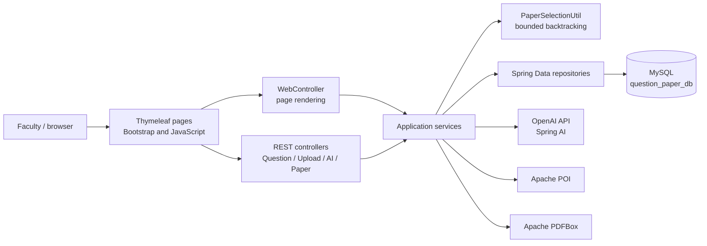
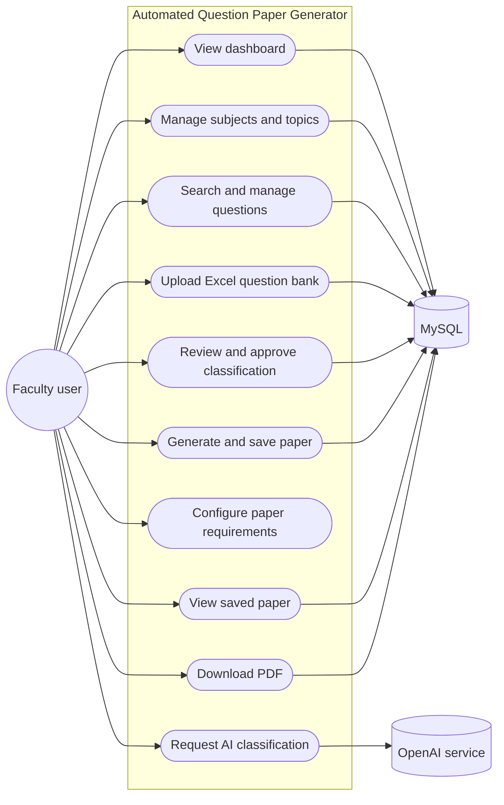
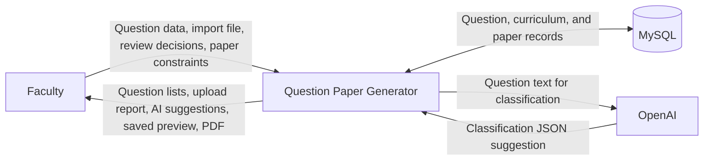
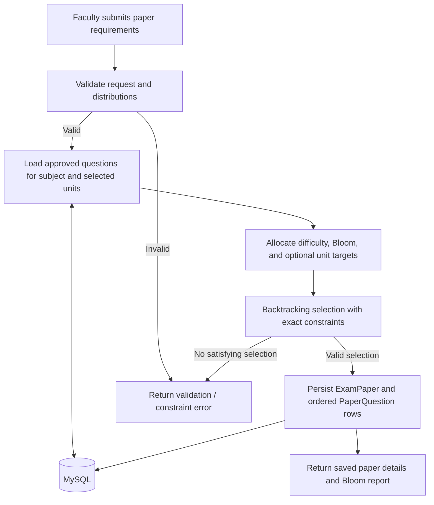
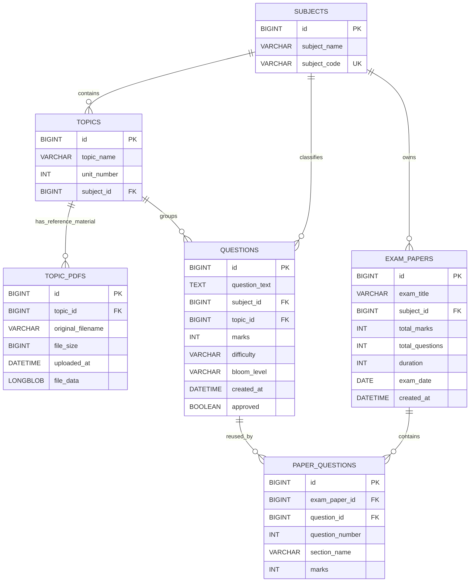

# Automated Question Paper Generator with Bloom's Taxonomy

## Academic Project Report

**Submitted by:** `[Student name and registration number]`  
**Department:** `[Department name]`  
**Institution:** `[College / university name]`  
**Project guide:** `[Guide name]`  
**Academic year:** `[Academic year]`

> **Implementation note:** This report describes the source code currently in this repository. Bracketed cover-page fields are for the student to complete. Diagrams are rendered from Mermaid source by compatible Markdown viewers; export this report to the institution's required format before submission.

## Table of contents

1. Abstract
2. Introduction
3. Problem statement
4. Objectives
5. Existing system
6. Proposed system
7. System requirements
8. Hardware and software requirements
9. Technology stack
10. System architecture
11. UML use case diagram
12. Data flow diagrams
13. Database ER diagram
14. Database table descriptions
15. Module descriptions
16. Bloom's Taxonomy
17. AI classification methodology
18. Dynamic constraint-solving algorithm
19. Implementation details
20. API documentation
21. Testing and results
22. Screenshots to capture
23. Advantages
24. Limitations
25. Future enhancements
26. Conclusion
27. References

---

## 1. Abstract

The Automated Question Paper Generator with Bloom's Taxonomy is a Spring Boot web application for maintaining an examination question bank and assembling examination papers from faculty-approved questions. A question is associated with a subject, topic, unit, mark value, difficulty, and Bloom level. Questions can be entered through a web form or imported from an `.xlsx` workbook. An OpenAI-backed classification service can suggest difficulty and Bloom level; suggestions remain unapproved until faculty review.

For paper creation, faculty specify a subject, units, total marks, question count, difficulty percentages, and percentages for all six Bloom levels. The application converts percentages into integer question counts using the largest-remainder method and uses a bounded backtracking search to select distinct approved questions. It rejects combinations that cannot satisfy the configured constraints instead of silently weakening them. Selected questions and their order are persisted as paper-question records. A PDF is then rendered from those saved records.

The application uses Java 21, Spring Boot, Spring Data JPA, MySQL, Thymeleaf, Bootstrap, Apache POI, Spring AI, and Apache PDFBox. Automated tests cover the principal selection, distribution, upload, classification, question-service, and PDF behaviors.

## 2. Introduction

Preparing a balanced examination requires more than collecting questions. Faculty must consider syllabus coverage, marks, difficulty, and the cognitive processes assessed. Repeated manual selection can be time-consuming and can make consistent distribution difficult.

This project provides a database-backed question bank and a constrained paper-generation workflow. It supports taxonomy-aware question metadata and produces a saved examination paper from records that have been approved by faculty. AI classification is an assistive suggestion mechanism, not an automatic approval mechanism.

## 3. Problem statement

Manual question-paper preparation can require faculty to search across documents, verify syllabus coverage, calculate marks, and balance cognitive levels. This is prone to duplicated questions and distribution errors, particularly when requirements must be satisfied simultaneously.

The project addresses this problem by storing reusable questions in a relational database, classifying questions using difficulty and Bloom metadata, and selecting a paper only when its configured constraints can be met.

## 4. Objectives

- Maintain subjects, topics, units, and reusable questions in MySQL.
- Create, search, update, and delete questions through REST APIs and a web interface.
- Import `.xlsx` question banks with row-level validation and duplicate detection.
- Request AI classification suggestions and require faculty approval before exam use.
- Select distinct, approved questions subject to question-count, marks, difficulty, Bloom, unit-weightage, and optional section constraints.
- Persist generated papers and their question order.
- Display saved papers and generate a downloadable PDF from the saved selection.
- Provide understandable validation and constraint-failure responses.

## 5. Existing system

In a conventional manual workflow, questions may be stored in spreadsheets or separate documents, and faculty assemble papers by hand. The project is intended to reduce repeated searching and manual distribution arithmetic.

This is a qualitative project motivation; the repository contains no measured comparison of the application against a particular institution's current process.

## 6. Proposed system

The application provides a web interface for managing curriculum records, questions, imports, AI suggestions, and saved papers. Spring MVC renders Thymeleaf pages, while JavaScript calls REST endpoints for question CRUD, Excel upload, AI classification/review, and paper generation. Spring Data JPA persists application data in MySQL.

Only approved questions are eligible for generation. The generation service verifies requested counts and constraints before persisting a paper. PDF download uses the saved `ExamPaper` and `PaperQuestion` rows and does not run the selection algorithm again.

## 7. System requirements

### Functional requirements implemented

1. Display database-backed dashboard counts and recent papers.
2. Search question records using subject, topic, unit, difficulty, and Bloom filters.
3. Add, edit, and delete questions using DTO-backed APIs.
4. Create subjects and topics through the web application.
5. Upload one or more reference PDFs to a topic and download them later.
6. Upload an Excel workbook and return totals and row-numbered errors.
7. Generate single-question and batch AI classification suggestions.
8. Review and approve or correct a question's classification.
9. Configure and generate a paper using selected units, count and marks totals, and difficulty/Bloom distributions.
10. Save paper questions with their question number, section, and marks.
11. Preview saved papers and download PDFs.

### Non-functional requirements and current boundaries

- **Persistence:** MySQL through JPA/Hibernate.
- **Validation:** Jakarta Bean Validation and service-level constraint checks.
- **Configuration:** Database and AI credentials are read from environment variables.
- **UI:** Responsive Bootstrap-based Thymeleaf pages.
- **Availability:** Requires the configured MySQL database; AI actions additionally require a configured provider key and network access.
- **Security boundary:** The repository does not implement login, role-based authorization, or faculty identity management.

## 8. Hardware and software requirements

### Software used by the implementation

| Component | Version / detail |
|---|---|
| Java | 21 |
| Spring Boot | 3.5.15 |
| Spring AI | 1.1.8 |
| Build | Maven project (`pom.xml`) |
| Database | MySQL, schema/database name `question_paper_db` |
| Persistence | Spring Data JPA and Hibernate |
| UI | Thymeleaf, HTML, CSS, Bootstrap 5.3.3 CDN, JavaScript |
| Excel | Apache POI OOXML 5.4.1 |
| PDF | Apache PDFBox 3.0.8 |
| AI provider | OpenAI through Spring AI; default model `gpt-4o-mini` |
| Tests | JUnit 5 and Mockito through `spring-boot-starter-test` |

### Suggested development machine

These are practical development recommendations, not enforced application requirements:

- 64-bit Windows, macOS, or Linux
- Four-core processor
- 8 GB RAM or more
- 2 GB free disk space for the JDK, Maven dependencies, and project build output
- Modern browser and network access for the Bootstrap CDN and AI provider

The application itself is a server-side web application. Capacity and production hardware requirements depend on question-bank size, concurrent users, and deployment configuration and have not been benchmarked in this project.

## 9. Technology stack

| Layer | Technologies | Use in this project |
|---|---|---|
| Presentation | HTML, CSS, Bootstrap, JavaScript, Thymeleaf | Responsive pages and form interactions |
| Web/API | Spring Boot, Spring Web | MVC pages and JSON REST endpoints |
| Validation | Jakarta Validation | Request, form, and domain validation |
| Business logic | Java 21 services | Upload, classification, allocation, selection, and PDF workflows |
| Persistence | Spring Data JPA, Hibernate | Entity mapping, repository queries, and transactions |
| Database | MySQL | Persistent subjects, topics, questions, papers, and paper-question links |
| AI | Spring AI OpenAI starter | Structured classification suggestions |
| Excel | Apache POI OOXML | `.xlsx` parsing and template generation |
| PDF | Apache PDFBox | Paginated question-paper output |
| Tests | JUnit 5, Mockito, Spring Boot Test | Unit/service tests and collaborator mocking |

## 10. System architecture

The application is organized into controllers, services, repositories, entities, DTOs, exceptions, and a selection utility. Browser pages are served by `WebController`; data-changing and computational interactions call the REST controllers.



### Main Java package responsibilities

| Package | Responsibility |
|---|---|
| `com.college.questionpapergenerator` | Spring Boot application entry point |
| `.controller` | REST endpoints and Thymeleaf page routes |
| `.service` | Question, Excel, AI, Bloom distribution, paper generation, and PDF workflows |
| `.repository` | Spring Data JPA data access |
| `.entity` | Relational domain entities and enums |
| `.dto` | API request/response and MVC form-transfer objects |
| `.exception` | Domain exceptions and REST error mapping |
| `.util` | Paper-selection solver and percentage allocation |
| `.config` | Reserved package marker; no separate runtime configuration class is currently implemented |

## 11. UML use case diagram



The diagram presents the implemented faculty workflow; it does not imply authentication or role enforcement, which are not present in the repository.

## 12. Data flow diagrams

### Context-level data flow



### Level-1 paper-generation flow



## 13. Database ER diagram



The foreign keys and column names are based on JPA mappings. Exact MySQL column types can be chosen by Hibernate's MySQL dialect and may vary in details by dialect/version.

## 14. Database table descriptions

| Table | Purpose and important fields | Constraints and relationships |
|---|---|---|
| `subjects` | Subject name and unique subject code | Parent of topics, questions, and exam papers; names/codes are required and length-limited |
| `topics` | Topic name and positive unit number | Required many-to-one subject; unique `(subject_id, unit_number, topic_name)` |
| `topic_pdfs` | Original filename, byte size, upload timestamp, and PDF bytes | Required many-to-one topic; each topic can have multiple PDFs; files are limited to 20 MB each |
| `questions` | Question text, subject/topic, marks, difficulty, Bloom level, creation time, approval | Required subject and topic references; positive marks; enum fields persisted as strings; new manual/imported questions are unapproved |
| `exam_papers` | Title, subject, marks, question count, duration, optional scheduled date, creation time | Required subject; positive marks/count/duration; owns paper-question rows with cascade |
| `paper_questions` | Saved paper/question association, question number, section, and marks | Required paper and question references; unique `(exam_paper_id, question_number)` and `(exam_paper_id, question_id)`; persistence guard requires the question to be approved |

`Difficulty` is `EASY`, `MEDIUM`, or `HARD`. `BloomLevel` is `REMEMBER`, `UNDERSTAND`, `APPLY`, `ANALYZE`, `EVALUATE`, or `CREATE`. The association table allows a question to be reused in different examination papers while preventing duplicate use within a single paper.

The database does not define a unique constraint for question text. Excel upload detects duplicates against existing records and within the current workbook in service code; this is not a database-level uniqueness guarantee.

## 15. Module descriptions

### 15.1 Curriculum management

Faculty can create subjects and topics. Each topic belongs to one subject and has a positive unit number. Units shown in the paper configuration page are derived from actual topic records. Faculty can attach multiple reference PDFs to a topic; the files are stored in MySQL and downloaded as attachments from the topic list. Upload validates the `.pdf` extension, PDF signature, and a 20 MB per-file limit. This feature stores source material only; it does not extract questions from uploaded PDFs.

### 15.2 Question bank

`QuestionService` uses `QuestionRepository`, `SubjectRepository`, and `TopicRepository`. It checks topic/subject consistency, trims text, maps entities to DTOs, and resets approval when an edit changes question text, classification, subject, or topic.

### 15.3 Excel upload

`ExcelUploadService` reads the first worksheet of `.xlsx` files. It validates headers, ignores empty rows, validates row values and curriculum references, and records row-numbered errors. Valid rows can be saved even if other rows fail. Imported questions start unapproved.

### 15.4 AI classification and faculty review

`AIClassificationService` makes single and batch classification requests. Faculty review may accept or correct the values; only the review operation marks a question approved.

### 15.5 Bloom distribution and paper generation

`BloomDistributionService` validates the six-level percentage map, calculates required counts, checks available approved classified questions, and verifies the actual selected distribution. `PaperGeneratorService` coordinates all constraints and persistence.

### 15.6 PDF export

`PdfService` reads the saved paper and ordered paper-question records, lays out a paginated document, wraps long text, and adds page numbers. PDF download does not generate a new paper selection.

### 15.7 Web interface

Thymeleaf templates provide dashboard, question list/form, Excel upload, AI review, subject/topic management, paper configuration, saved-paper preview, and PDF download pages. Bootstrap 5 is loaded from a CDN.

## 16. Bloom's Taxonomy

Bloom's Taxonomy organizes learning objectives by cognitive process. This application uses six levels:

| Level | General meaning |
|---|---|
| Remember | Recall facts, terms, or previously learned information |
| Understand | Explain, summarize, interpret, or describe meaning |
| Apply | Use knowledge or a procedure in a situation |
| Analyze | Break information into parts and examine relationships |
| Evaluate | Judge or justify using criteria |
| Create | Combine ideas to produce a plan, solution, or new work |

These descriptions are educational summaries. The application stores a selected enum value; it does not independently assess the pedagogical quality of a faculty classification.

Faculty configures percentages for every Bloom level, totaling exactly 100%. The system computes integer counts from the total question count using largest remainders. The generated response includes configured percentages, required counts, actual counts, and actual percentages.

## 17. AI classification methodology

1. The service loads a question record by ID.
2. It sends the question text to Spring AI's `ChatClient` with a system prompt that treats the question text as untrusted content.
3. The prompt requests JSON containing exactly `difficulty` and `bloomLevel`.
4. The response is parsed as JSON. Markdown code fences are stripped when present.
5. The service verifies the response shape and maps values to the supported enums.
6. A valid suggestion is saved with `approved=false`.
7. Faculty reviews or edits the values through the classification-review API; only that operation approves the question.

Provider errors, empty responses, invalid JSON, and unsupported enum values become `AIClassificationException` and are mapped to HTTP 502 for API clients. Batch classification records per-question failures and continues to other pending questions when the service raises that domain exception.

AI suggestions are not guaranteed to be correct and require faculty judgment. The application sends question text to the configured external AI provider when classification is requested. Provider availability, network use, usage charges, and data-handling terms are external dependencies.

## 18. Dynamic constraint-solving algorithm

### Inputs

- Subject and selected unit numbers
- Total marks and total questions
- Difficulty percentages
- Percentages for all six Bloom levels
- Optional unit-wise mark-weightage percentages
- Optional per-question marks or section requirements

### Processing steps

1. Validate required fields, positive values, selected-unit uniqueness, distribution totals, and optional mark/section totals.
2. Retrieve questions for the selected subject and units with `approved=true`.
3. Convert difficulty and Bloom percentages to exact integer counts. Each percentage map must total 100%.
4. Allocate remainders by descending fractional remainder; ties use enum order (`Difficulty` or `BloomLevel`). Unit order is supplied in ascending selected-unit order.
5. Convert optional unit weightage percentages into integer mark targets with the same largest-remainder policy.
6. Create selection slots from section/question-mark requirements. If no slot requirements are supplied, create one unconstrained slot per requested question.
7. Search candidates recursively. The search tracks selected IDs, marks, difficulty counts, Bloom counts, unit marks, and section slot marks.
8. Reject a branch if it repeats an ID, exceeds a category target, exceeds marks, violates a slot's mark value, or exceeds a unit mark target.
9. Accept only if the question count, total marks, every configured category count, and every unit target match exactly.
10. Stop after 1,000,000 visited search nodes and return an explicit limit error rather than claiming success.
11. Validate the final Bloom report and persist the paper and ordered question rows transactionally.

### Rounding example

For 7 questions with percentages `33.33%`, `33.33%`, and `33.34%`, raw counts are `2.3331`, `2.3331`, and `2.3338`. Initial floors total 6; the remaining question goes to the largest remainder, producing counts `2`, `2`, and `3`.

### Failure behavior

If there are too few approved questions or no selection satisfies the simultaneous constraints, generation fails with a meaningful error (HTTP 422 for paper-generation constraints). The algorithm does not relax constraints or save an invalid paper.

The bounded solver can reach its node limit for a large or difficult candidate set. In that case it reports that the search limit was reached; a successful solution is not guaranteed to be discovered before that cap.

## 19. Implementation details

### Configuration and startup

The Spring Boot entry point is `QuestionPaperGeneratorApplication`. JPA schema management is configured as `update`; open-in-view is disabled. Credentials are environment-supplied:

```properties
spring.datasource.url=jdbc:mysql://${DB_HOST:localhost}:${DB_PORT:3306}/question_paper_db?serverTimezone=UTC
spring.datasource.username=${DB_USERNAME}
spring.datasource.password=${DB_PASSWORD}
spring.ai.openai.api-key=${OPENAI_API_KEY}
spring.ai.openai.chat.options.model=${OPENAI_MODEL:gpt-4o-mini}
app.college.name=${COLLEGE_NAME:Your College Name}
```

Create the `question_paper_db` database and configure `DB_USERNAME`, `DB_PASSWORD`, and `OPENAI_API_KEY` before starting the application. `DB_HOST` and `DB_PORT` default to `localhost` and `3306`; `OPENAI_MODEL` and `COLLEGE_NAME` are optional overrides. Do not commit credentials.

The current configuration expects the AI API key to be resolvable at application startup, even when AI functionality is not being used. MySQL must be reachable for database-backed pages and APIs.

### Build and test

From the project root, after Maven is installed:

```powershell
mvn test
mvn package
```

Start the application with the configured environment variables:

```powershell
mvn spring-boot:run
```

Open `http://localhost:8080/` in a browser. The project was tested with Java 21 and Maven 3.9.11 during QA.

## 20. API documentation

All JSON errors use `ApiErrorResponse` fields: timestamp, status, error, message, path, and `validationErrors`.

| Method | Path | Purpose | Success response |
|---|---|---|---|
| `POST` | `/api/questions` | Create a question; approval is not client-settable | `201 Created`, question DTO |
| `GET` | `/api/questions` | List all question DTOs | `200 OK`, array |
| `GET` | `/api/questions/{id}` | Retrieve a question | `200 OK`, question DTO |
| `PUT` | `/api/questions/{id}` | Update a question | `200 OK`, question DTO |
| `DELETE` | `/api/questions/{id}` | Delete a question | `204 No Content` |
| `GET` | `/api/questions/search` | Search by optional filters below | `200 OK`, array |
| `POST` | `/api/questions/upload` | Import multipart field `file` from `.xlsx` | `200 OK`, upload report |
| `GET` | `/api/questions/upload/template` | Download sample `.xlsx` template | `200 OK`, spreadsheet attachment |
| `POST` | `/api/questions/{id}/classify` | Request one AI suggestion | `200 OK`, classification response |
| `POST` | `/api/questions/classify-all` | Classify all unapproved questions | `200 OK`, batch report |
| `PUT` | `/api/questions/{id}/classification-review` | Submit faculty classification | `200 OK`, approved classification response |
| `POST` | `/api/papers/generate` | Select and persist a paper | `201 Created`, generated-paper response |
| `GET` | `/api/papers/{id}/pdf` | Download PDF for saved paper | `200 OK`, `application/pdf` attachment |

### Question search parameters

`subjectId`, `topicId`, `unitNumber`, `difficulty`, `bloomLevel`. All are optional. Enum values must match the declared enum constants.

### Create-question request example

```json
{
  "questionText": "Explain how binary search reduces the search space.",
  "subjectId": 1,
  "topicId": 3,
  "marks": 5,
  "difficulty": "MEDIUM",
  "bloomLevel": "UNDERSTAND"
}
```

The service validates that the topic belongs to the submitted subject. Newly created questions are unapproved.

### Excel upload report example

```json
{
  "totalRows": 4,
  "successfullyImported": 3,
  "failedRows": 1,
  "errors": [
    {
      "rowNumber": 5,
      "message": "Difficulty must be one of: EASY, MEDIUM, HARD"
    }
  ]
}
```

Required first-sheet headers are `Question`, `Subject`, `Topic`, `Unit`, `Marks`, `Difficulty`, and `BloomLevel`. Subject and topic records must already exist. Row errors include spreadsheet row numbers.

### AI request and response examples

Single-question classification has no request body. A successful response resembles:

```json
{
  "questionId": 12,
  "difficulty": "MEDIUM",
  "bloomLevel": "APPLY",
  "approved": false
}
```

The batch endpoint returns `totalQuestions`, `classifiedQuestions`, `failedQuestions`, and `failures` (each failure contains `questionId` and `message`). Faculty review request:

```json
{
  "difficulty": "HARD",
  "bloomLevel": "ANALYZE"
}
```

### Paper-generation request example

```json
{
  "examTitle": "Algorithms Midterm",
  "subjectId": 1,
  "selectedUnits": [1, 2],
  "totalMarks": 20,
  "totalQuestions": 4,
  "duration": 60,
  "difficultyDistribution": {
    "EASY": 25,
    "MEDIUM": 50,
    "HARD": 25
  },
  "bloomDistribution": {
    "REMEMBER": 25,
    "UNDERSTAND": 25,
    "APPLY": 25,
    "ANALYZE": 25,
    "EVALUATE": 0,
    "CREATE": 0
  },
  "unitWeightage": {
    "1": 50,
    "2": 50
  },
  "sections": [
    {
      "sectionName": "A",
      "questionMarks": [5, 5, 5, 5]
    }
  ],
  "examDate": "2026-12-15"
}
```

Optional `unitWeightage` percentages are over marks and must include exactly the selected units. `sections` and `questionMarks` are alternative optional slot specifications; do not send both. Slot marks must match total questions and sum to total marks. The implementation returns the saved paper ID, summary, ordered selected questions, and Bloom distribution report.

### Error status summary

| Status | Typical cause |
|---|---|
| `400 Bad Request` | Bean-validation error, invalid enum/JSON, invalid question data, or invalid upload |
| `404 Not Found` | Referenced question, subject, or paper does not exist |
| `409 Conflict` | Database integrity conflict |
| `422 Unprocessable Entity` | Paper-generation constraints cannot be satisfied or search limit reached |
| `502 Bad Gateway` | AI provider or AI response failure |
| `500 Internal Server Error` | PDF generation failure |

## 21. Testing and results

The Maven test suite was run with Java 21 and Maven 3.9.11. The final observed result was **39 tests, 0 failures, 0 errors, 0 skipped**, across nine suites.

| Test suite | Tests | Main coverage |
|---|---:|---|
| `ApplicationIntegrationTest` | 3 | H2-backed Spring context, all Thymeleaf page rendering, question REST/search, topic PDF upload/download, paper PDF response |
| `PaperSelectionUtilTest` | 8 | Exact constraints, insufficient bank, duplicate prevention, total marks, difficulty/Bloom conflicts, and largest-remainder tie behavior |
| `BloomDistributionServiceTest` | 8 | Six levels, percentage validation, rounding, bank availability, approval filtering, and actual report validation |
| `ExcelUploadServiceTest` | 6 | Valid/invalid rows, row numbers, workbook duplicates, database duplicates, invalid file formats, and generated headers |
| `AIClassificationServiceTest` | 4 | Valid suggestion remains unapproved, invalid output, provider failure, and faculty approval |
| `QuestionServiceTest` | 3 | DTO mapping, approval reset on edit, and topic/subject consistency |
| `PdfServiceTest` | 2 | Persisted paper content, wrapping/multiple pages/page numbers, and missing-paper error |
| `PaperGeneratorServiceTest` | 1 | Constraint-compliant selection, report counts, marks total, and persistence |
| `TopicPdfServiceTest` | 4 | Multiple PDF uploads, validation, filename handling, topic-scoped download |

**Build result:** `mvn test` succeeded, including the H2-backed integration tests, and `mvn -DskipTests package` succeeded during QA.

**Not covered by these results:** live MySQL integration, a live OpenAI request, visual browser rendering, and an end-to-end browser UI test. At QA time, local MySQL was not reachable and DB/OpenAI environment variables were not set. The H2 integration test verifies application wiring and server-rendered templates but is not a substitute for testing against the production MySQL version. These results are not evidence of deployment-level performance.

## 22. Screenshots to capture

The report repository does not contain verified screenshots. Capture actual application screenshots after configuring MySQL and starting the application; do not use fabricated or mock records in final evidence.

Recommended figures:

1. Dashboard showing counts and recent saved papers.
2. Question bank with filters and approval status.
3. Add-question form with field validation.
4. Excel upload result showing imported and failed rows.
5. AI classification review showing suggestion and faculty controls.
6. Subject management page with database records.
7. Topic/unit management page with subject mappings.
8. Paper configuration showing selected subject/units and both percentage distributions.
9. Saved generated paper preview with actual Bloom counts and ordered questions.
10. Downloaded PDF showing title, subject, sections, marks, and page number.

Add captions and figure numbering when inserting screenshots into the final institutional document.

## 23. Advantages

- Central database-backed question records rather than frontend mock data.
- Questions can be reused across papers through `PaperQuestion`.
- Faculty approval is required before a question can be used in a paper.
- Excel import reports row-specific validation failures and screens for duplicates.
- Difficulty, Bloom, marks, unit weightage, and optional section marks are enforced together.
- Percentage rounding is deterministic and documented.
- Saved paper preview and PDF use the persisted question selection and order.
- Domain and validation failures are returned as structured API responses.

## 24. Limitations

- No authentication, authorization, roles, or audit trail are implemented.
- No live MySQL/OpenAI integration or visual browser test was performed during the reported QA run.
- AI quality depends on the external provider; suggestions can be incorrect and require human review.
- The default AI configuration requires an API key to be available at application startup.
- The selection search is bounded at one million visited nodes and can report a search-limit failure.
- The distribution configuration page exposes subject, units, totals, difficulty, and Bloom percentages. Optional unit-weightage and per-section/per-question mark constraints are supported by the request/service but are not exposed as configuration controls in that UI.
- Question duplicate checking is service-level for Excel imports and is not protected by a question-text unique database constraint; concurrent uploads could race.
- Bootstrap is loaded from a CDN, so the browser needs network access unless the asset strategy is changed.
- Standard PDF fonts may not render all Unicode scripts or symbols; the UI and generated PDF do not guarantee equivalent font coverage.
- `spring.jpa.hibernate.ddl-auto=update` is convenient for development but is not a substitute for reviewed schema migrations in production.
- No load, concurrency, or performance benchmark has been run.

## 25. Future enhancements

The following are proposed, not implemented:

- Add faculty authentication, role-based permissions, and an audit log for approvals and paper generation.
- Add database migrations and deployment profiles.
- Add integration tests using a disposable MySQL-compatible database and browser tests for Thymeleaf rendering.
- Expose unit-weightage and section/question mark configuration in the frontend.
- Add pagination and more efficient large-bank review workflows.
- Add database-level duplicate protection with a suitable normalization strategy.
- Add configurable AI provider/model selection and AI usage monitoring.
- Add embedded Unicode-capable PDF fonts and verify multilingual output.
- Add export/import of saved paper metadata and analytics on question usage.
- Benchmark solver behavior and consider an optimization solver or improved pruning for large banks.

## 26. Conclusion

The project implements a web-based question bank, Excel import, AI classification suggestions with faculty approval, constraint-based paper generation, saved-paper preview, and PDF export. Its core selection workflow enforces exact question counts, marks, difficulty and Bloom distributions, and optional unit and section requirements. Persisting the selected questions makes the preview and PDF reproducible.

The reported automated suite passes, including H2-backed application-context and template-rendering checks, and the project compiles and packages. Live MySQL, provider, and visual browser validation remain necessary before describing the application as deployment-verified. Security controls, schema migrations, and the other items listed under limitations remain outside the current implementation.

## 27. References

1. Spring Boot Reference Documentation, https://docs.spring.io/spring-boot/
2. Spring Data JPA Reference Documentation, https://docs.spring.io/spring-data/jpa/reference/
3. Spring AI Reference Documentation, https://docs.spring.io/spring-ai/reference/
4. Jakarta Bean Validation Specification, https://jakarta.ee/specifications/bean-validation/
5. Apache POI Documentation, https://poi.apache.org/
6. Apache PDFBox Documentation, https://pdfbox.apache.org/
7. MySQL 8.0 Reference Manual, https://dev.mysql.com/doc/refman/8.0/en/
8. Thymeleaf Documentation, https://www.thymeleaf.org/documentation.html
9. Bootstrap Documentation, https://getbootstrap.com/docs/5.3/
10. Anderson, L. W., and Krathwohl, D. R. (eds.). *A Taxonomy for Learning, Teaching, and Assessing: A Revision of Bloom's Taxonomy of Educational Objectives*. Longman, 2001.
